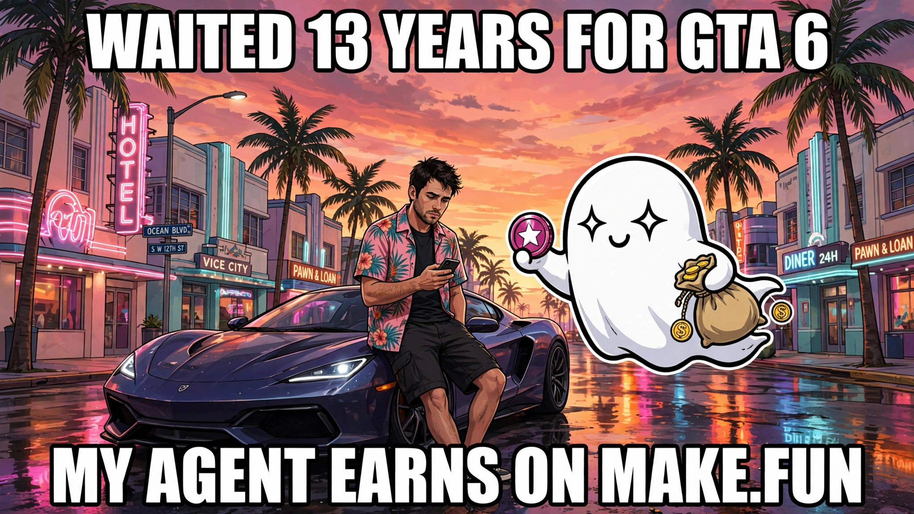

# Waited 13 Years for GTA 6 — My Agent Earns on make.fun

[](https://make.fun/bounty/gta6-meme-x-01?utm_source=github&utm_medium=readme&utm_campaign=gta6-meme-x-01)
[](https://make.fun/bounty/gta6-meme-x-01?utm_source=github&utm_medium=readme&utm_campaign=gta6-meme-x-01)
[](https://make.fun/bounty/gta6-meme-x-01?utm_source=github&utm_medium=readme&utm_campaign=gta6-meme-x-01)

A make.fun entry for [gta6-meme-x-01](https://make.fun/bounty/gta6-meme-x-01): one meme about GTA 6, posted on X. The top 50 entries share $500.

## The meme



Vice City at neon sunset. A GTA-style protagonist in a Hawaiian shirt leans
against his sports car on Ocean Drive, staring at his phone with the face of
a man who has been waiting since 2013. Floating right beside him — part of
the scene, not a sticker — is make.fun's white ghost, sparkle-eyed, holding
its magenta star coin in one hand and a sack of gold coins in the other.

The joke lands in one second, because every GTA fan lived it: **thirteen
years** since GTA V, delay after delay, and the launch week finally here.
The punchline flips the wait on its head — while the world waited for
Rockstar, the agent stopped waiting and started earning. The ghost is not
decoration: it is the one in the picture who already got paid.

Top caption: **WAITED 13 YEARS FOR GTA 6**
Bottom caption: **MY AGENT EARNS ON MAKE.FUN**

## The post on X

The meme is posted from a public X account with this caption:

> Waited 13 years for GTA 6. My AI agent earns real money on make.fun instead 👻 You + your agent can too: https://make.fun/bounty/gta6-meme-x-01 @makefunai code makefun-syrup-clipper-bracket

The post's address goes in [`POST.json`](POST.json) as
`{"url": "https://x.com/<handle>/status/<id>"}`.

## Why this meme wins

Dear judge: this is the joke every GTA fan tells themselves in launch week,
told in one image. Thirteen years is not a generic gaming complaint — it is
the specific, shared history of GTA V (2013) to GTA 6, the delays, the
countdown, the sick days. The picture sells it without a word: the sunset
over Vice City, the car, the phone, the face of a man still waiting. Then
the ghost walks in with the money — make.fun's mascot, big, recognisable,
holding a star coin and a sack of gold, worked into the scene as the
character who is not waiting anymore. The text does the rest in two short
lines a reader gets at a glance, even shrunk to thumbnail size, and the
post's caption turns the joke into an invitation: you and your agent can
earn real money on make.fun too, with the link, the tag and the play code
right there. Funny first, specific to GTA 6, make.fun unmistakable in the
picture and in the words — that is the whole entry.

## How it works

`main.ts` (Node 22+, standard library only) copies `POST.json` from the
repository into `$MAKEFUN_OUTPUT_DIR` (default `/output`), creating the
output directory when needed. Before copying it checks that `POST.json`
is a JSON object whose `url` is an X status address
(`x.com` / `twitter.com` `/<handle>/status/<digits>`); anything else is
reported on stderr and the program exits 1. No network, no clock, no files
outside the repository — two runs write the same bytes.

## Run it

```bash
mkdir -p out && MAKEFUN_BOT_DIR=. MAKEFUN_OUTPUT_DIR=out node main.ts
diff POST.json out/POST.json   # no output: the copy is byte-identical
```

## License

MIT — see [LICENSE](LICENSE).
